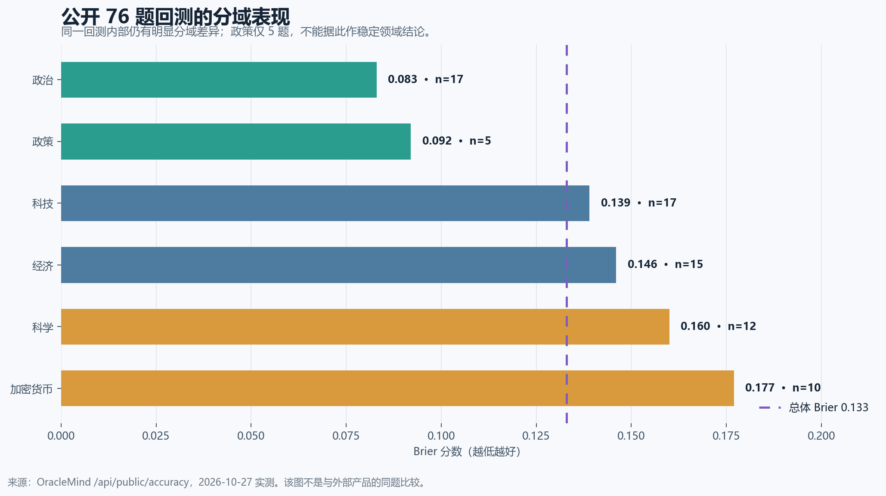
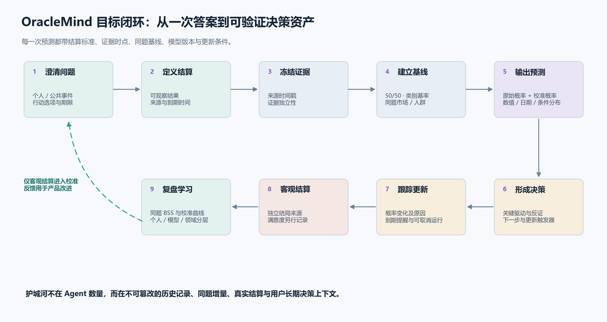

# OracleMind 项目全面提升报告

**审计日期：2026-10-27**  
**审计对象：`C:\Users\xing\Desktop\oraclemind\vercel-deploy` 与公开站点 `oraclemind.cc`**  
**视角：预测科学、AI 产品、Agent 工程、消费体验、数据治理与未来竞争定位**

## 1. 执行摘要：不是再增加功能，而是把每次回答变成可验证的决策资产

OracleMind 已经具备远超普通早期项目的功能广度：个人推演、公共事件、竞技场、日记、公开准确率、概率校准、保形预测、前瞻封存、记忆、支付、自动化与多 Agent 编排均已出现。当前最主要的问题不是“项目不完整”，而是**过多技术模块围绕一个尚未完全统一的核心语义运转**：概率、倾向、共识、满意度和真实结局在部分链路中仍然混用。继续增加页面、Agent 或模型，会放大这种不一致，而不会自动形成科技壁垒。

建议把项目的下一级定位明确为：**可验证的 AI 决策与预测工作台**。它不以“最像玄学大师”或“Agent 最多”为竞争目标，而让每一份结果都具备明确问题、可结算标准、证据时点、同题基线、原始与校准概率、行动选项、更新触发器、客观结局和复盘记录。公共事件轨负责证明预测增量，个人决策轨负责沉淀长期上下文和决策质量；古典框架可以作为独立、可关闭、可单独评测的解释视角保留，但不应与客观证据混成等权科学证据。

未来十二个月应围绕三个壁垒建设。第一是**证据壁垒**：不可改写的预测历史、版本化模型与校准器、同题同时间比较。第二是**数据壁垒**：用户授权的个人决策记录、真实到期结算、分领域校准曲线，而非满意度日志。第三是**工作流壁垒**：从提问到行动、提醒、结算、复盘的完整闭环，并通过 API/MCP 进入用户已有的 AI 工具。模型本身会快速商品化，以上三类资产更难被通用聊天模型替代。

优先级非常清楚：**0–2 周修正确性、权限与真值污染；3–6 周统一数据契约、完成时间外验证和同题基线；7–12 周推出盲测竞技场、动态公开榜单和结构化决策报告；3–6 个月再扩展团队决策、共享证据图谱和外部接口。** 在此之前，不应用跨数据集 Brier 分数宣称领先，也不应急于训练自有预测模型。

## 2. 审计边界与最新实测基线

本次覆盖源码结构、主要页面与 API、预测和反馈链路、数据库契约、测试与构建、公开健康及准确率接口，并对 ForecastBench、Metaculus、FutureSearch、Mantic、Co-Star、MCP、AG-UI、Agent 评估、在线校准、NIST 与欧盟 AI 治理资料进行了交叉调研。审计属于静态代码审查与黑盒公开接口核验，不包含付费账号全流程点击、数据库直接取证、压力测试或渗透测试；因此不能替代完整安全审计和真实用户研究。

项目当前有 **403 个 TS/TSX 文件、92,012 行源码、29 个页面、88 个 API 路由、29 个测试文件和 45 个引擎文件**。最新实测结果如下；数字反映本次执行时刻，不应被理解为长期服务水平。

| 检查项 | 本次实测结果 | 正确解读 |
|---|---:|---|
| 自动化测试 | **29/29 套件、313/313 用例通过** | 回归基础较好；日志含预期的 mock 错误，不等于生产异常 |
| 完整类型检查 | **25 项错误** | 24 项位于测试代码，1 项位于生产代码 |
| 持续集成类型检查 | **1 项错误** | `domain-prior.ts` 的联合类型不匹配，CI 尚不能全绿 [domain-prior](kimi-cite://text?path=C%3A%2FUsers%2Fxing%2FDesktop%2Foraclemind%2Fvercel-deploy%2Fsrc%2Flib%2Fengines%2Fdomain-prior.ts&text=decl.prohibitedUse.includes%28declaredUse%29 "citation") |
| 代码规范 | **361 项：130 errors、231 warnings** | 包含测试、脚本、覆盖率产物等；应分目录治理，而非一次性机械修复 |
| 生产构建 | 运行至 Next.js 16.2.11 优化构建阶段，**5 分钟超时前未完成** | 只能记为“本地构建未在时限内完成”，不能断言构建成功或失败 |
| 线上健康接口 | API、数据库 healthy；cache unknown | 表明公开健康检查正常，不代表所有业务链路正常 [OracleMind health](kimi-cite://web?url=https%3A%2F%2Foraclemind.cc%2Fapi%2Fhealth "citation") |
| 公开事件回测 | **76 题，Brier 0.133，95% CI 0.1067–0.1594，方向准确率 82.9%** | 系统自身标记 weak、`canClaimSkill:false`，适合趋势观察，不足以证明超越市场 [OracleMind accuracy](kimi-cite://web?url=https%3A%2F%2Foraclemind.cc%2Fapi%2Fpublic%2Faccuracy "citation") |

公开接口逐题列出预测值、市场 midpoint、结局与误差，并明确个人轨不作准确率宣称，这是值得保留的透明度基础。分域结果同时说明不能只看总分：政治为 0.083，而加密货币为 0.177；政策仅 5 题，任何“擅长某领域”的结论都还为时过早。

## 3. 现有优势与成熟度判断

项目最有价值的资产不是页面数量，而是已经出现的一组“可信预测”雏形：公开逐题记录、弱样本提示、确定性复现、个人与公共事件分轨、竞技场的人群先验 BSS、前瞻封存入口，以及原始/校准概率的数据字段。这些方向与前沿预测评测一致，说明团队并非缺少科学意识；真正的问题是**科学组件之间还没有形成严格的数据语义和实验纪律**。

下表是基于代码与实测的专家判断，不是用户统计或第三方评级。它用于确定投资顺序，而非给项目贴一个永久标签。

| 维度 | 当前成熟度（5 分制） | 已有基础 | 距离下一等级的主要差距 |
|---|---:|---|---|
| 功能完整性 | 4.0 | 预测、日记、竞技场、支付、分享、公开评估 | 功能过宽，主价值被稀释，需收缩首屏与导航 |
| 互动与流程 | 3.0 | SSE 阶段反馈、情景、回填、打卡与分享 | 从“看完报告”到“行动—到期—结算”的闭环不牢 |
| AI 工程广度 | 3.5 | 多 Agent、RAG、记忆、反思、工具、结构化输出 | 缺统一 trace、版本化评测、成本—质量路由 |
| 预测科学有效性 | 1.8 | Brier、ECE、校准、保形、公开回测 | 输入语义、真值来源、时间外验证和同题增量未打通 |
| 数据治理与安全 | 1.8 | 数据表已有来源和回填标记 | 反馈归属、三类反馈分离、分享签名和权限仍需整改 |
| 可维护与交付质量 | 2.5 | 313 条测试全部通过 | 类型、lint、构建、巨型页面和关键 E2E 尚未形成门禁 |
| 消费级增长潜力 | 3.0 | 个性化、日记、竞技场、分享卡 | 分享内容可伪造，留存依赖打卡而非真实决策价值 |
| 前沿定位潜力 | 3.5 | 已有可验证预测的若干关键组件 | 需要把组件收敛为难复制的数据与工作流壁垒 |

合理的战略不是推倒重来，而是**冻结非核心扩张，把现有宽平台压缩成一条可信主链路**。当这条链路可以稳定产生可结算记录后，现有大量模块才会从成本中心变成可组合能力。

## 4. 必须先修复的关键断点

以下问题比新增功能更重要，因为它们会改变用户看到的含义、污染校准数据或使公开比较失去效力。修复顺序应是“语义和权限先于算法，算法先于界面扩展”。

尤其需要注意，本次最新代码已经把温度缩放接入个人推演科学层，因此不能再笼统地说“校准未接线”。新问题是：**校准输入与输出契约仍不正确，验证材料未形成可复核证据，且原始/校准双概率没有完整落库。**

| 优先级 | 已核实断点 | 影响 | 可落地修复与验收 |
|---|---|---|---|
| P0 | 个人 SSE 将现代/古典共识的均值直接作为 `rawIndex`；该均值理论范围为 −1～+1，而校准器要求 0～1 [stream route](kimi-cite://text?path=C%3A%2FUsers%2Fxing%2FDesktop%2Foraclemind%2Fvercel-deploy%2Fsrc%2Fapp%2Fapi%2Fsimulate%2Fpersonal%2Fstream%2Froute.ts&text=const%20rawIndex%20%3D%20%28modern%20%2B%20classical%29%20%2F%202%3B "citation") | 负共识会被钳到 0.01，科学层可能与三情景结果互相矛盾 | 定义唯一 `P(target outcome)`；所有入口先做 schema 与范围校验。添加负值、0、1、NaN、三情景一致性的端到端测试 |
| P0 | 科学层调用保形函数后，返回对象的 `lower/upper` 仍固定为 0 和 1 [science-layer](kimi-cite://text?path=C%3A%2FUsers%2Fxing%2FDesktop%2Foraclemind%2Fvercel-deploy%2Fsrc%2Flib%2Fscience-layer.ts&text=lower%3A%200%2C%0A%20%20%20%20%20%20upper%3A%201%2C "citation") | 看似提供科学证书，实际没有传达计算出的预测集 | 二元任务返回 `predictionSet:{0,1}` 与可靠性，不伪装为数值置信区间；数值任务另返分位区间并报告覆盖率 |
| P0 | 顶部取概率最高的情景，却统一写成“chance things go well”；若 conservative 最高，语义会反转 [page](kimi-cite://text?path=C%3A%2FUsers%2Fxing%2FDesktop%2Foraclemind%2Fvercel-deploy%2Fsrc%2Fapp%2Fpage.tsx&text=chance%20things%20go%20well "citation") | 用户可能把“最可能是不利情景”理解为“顺利概率” | 顶部展示“最可能情景：保守，P=xx%”；另设明确的 `P(optimistic)`，禁止共用变量。三种最高情景均有文案测试 |
| P0 | 即时“准/不准”虽已注明是主观自报，仍映射为 positive/negative 进入校准；partial 被评分过滤，但 confirmed/denied 仍会被当作客观结局 [outcome-return](kimi-cite://text?path=C%3A%2FUsers%2Fxing%2FDesktop%2Foraclemind%2Fvercel-deploy%2Fsrc%2Fcomponents%2Fmodules%2Foutcome-return.tsx&text=%E5%8D%B3%E6%97%B6%E8%87%AA%E6%8A%A5 "citation") | 满意度、认同度与真实结局混淆，校准曲线可能被用户偏好塑形 | 分成 `usefulness`、`agreement`、`resolved_outcome` 三类表/事件；只有最后者且有结算标准与来源时进入 Brier |
| P0 | 反馈端点信任请求体 userId，缺明确鉴权和记录归属校验 [feedback route](kimi-cite://text?path=C%3A%2FUsers%2Fxing%2FDesktop%2Foraclemind%2Fvercel-deploy%2Fsrc%2Fapp%2Fapi%2Ffeedback%2Fverify%2Froute.ts&text=const%20userId%20%3D%20body.userId%20%7C%7C%20%27anonymous%27%3B "citation") | 可能越权改写他人记录、公开统计和校准样本 | 服务端取身份、校验 simulation 所属用户、加幂等键和限流；匿名反馈只进入产品体验表，不写客观真值 |
| P0 | 公开接口把自家 76 题与硬编码的超级预测员、市场、RAG LLM 分数并排 [accuracy route](kimi-cite://text?path=C%3A%2FUsers%2Fxing%2FDesktop%2Foraclemind%2Fvercel-deploy%2Fsrc%2Fapp%2Fapi%2Fpublic%2Faccuracy%2Froute.ts&text=const%20BENCHMARKS%20%3D%20%5B "citation") | 数据集、时间与难度不同，不构成同尺竞争证据 | 移除排名式展示，改为方法注释；上线同题、同预测时点、同结算的 paired leaderboard |
| P1 | 事件引擎以 `eventPrior` 为主锚，再加确定性扰动 [prediction-engine](kimi-cite://text?path=C%3A%2FUsers%2Fxing%2FDesktop%2Foraclemind%2Fvercel-deploy%2Fsrc%2Flib%2Fprediction-engine.ts&text=base%20%3D%20Math.max%280%2C%20Math.min%281%2C%20input.eventPrior%29%29%3B "citation") | 0.133 可能主要来自市场先验，无法证明独立增量 | 每题同时保存纯市场先验、50/50、类别基率与模型结果，发布 ΔBrier、BSS 和配对置信区间 |
| P1 | 多 Agent 文本通过英文关键词计数提取方向，再以固定线性映射生成三情景概率 [scenario-synthesizer](kimi-cite://text?path=C%3A%2FUsers%2Fxing%2FDesktop%2Foraclemind%2Fvercel-deploy%2Fsrc%2Flib%2Fengines%2Fscenario-synthesizer.ts&text=const%20avgC%20%3D%20%28modernC%20%2B%20classicalC%29%20%2F%202%3B "citation") | “共识”不等于独立验证，也不天然是校准概率 | 用结构化 Agent 输出替代关键词；聚合时按证据相关性和历史表现加权，并做消融实验 |
| P1 | 个人 SSE 在科学层生成前，已用第一个情景的原始概率写反馈；未同步该校准结果 [stream route](kimi-cite://text?path=C%3A%2FUsers%2Fxing%2FDesktop%2Foraclemind%2Fvercel-deploy%2Fsrc%2Fapp%2Fapi%2Fsimulate%2Fpersonal%2Fstream%2Froute.ts&text=await%20recordPredictionFeedback%28simulationId%2C%20userId%2C%20question%2C%20predictedProb%2C%20predictedDir%29%3B "citation") | 数据表虽有 calibrated 字段，原始/校准双曲线仍可能缺数 | 在一个事务中创建完整 ForecastRecord，再发送 complete；原始、校准、校准器版本和基线均必填 |
| P1 | 付费报告中的“2–4 周行动”“第 3 周阻力”等由概率区间模板生成 [page](kimi-cite://text?path=C%3A%2FUsers%2Fxing%2FDesktop%2Foraclemind%2Fvercel-deploy%2Fsrc%2Fapp%2Fpage.tsx&text=Unexpected%20resistance%20around%20week%203 "citation") | 付费内容看似具体，实际不是从证据动态推导 | 删除无证据时间断言；改为证据驱动触发器、可逆行动、条件场景与替代方案比较 |
| P1 | 竞技场身份仅依赖可写 cookie，分享卡直接读取 URL JSON [arena submit](kimi-cite://text?path=C%3A%2FUsers%2Fxing%2FDesktop%2Foraclemind%2Fvercel-deploy%2Fsrc%2Fapp%2Fapi%2Farena%2Fsubmit%2Froute.ts&text=req.cookies.get%28%27om_arena_guest%27%29 "citation") [arena page](kimi-cite://text?path=C%3A%2FUsers%2Fxing%2FDesktop%2Foraclemind%2Fvercel-deploy%2Fsrc%2Fapp%2Farena%2Fpage.tsx&text=JSON.parse%28decodeURIComponent%28raw%29%29 "citation") | 排行榜与分享战绩不能作为严格研究或可验证证明 | 使用签名 guest token、服务端成绩 ID 和最小样本门槛；保留娱乐榜但标记非严格实验 |
| P1 | `ResultView` 在空结果提前返回后才调用 Hook | 结果有无切换时存在 Hooks 顺序风险 | 将 Hook 移到所有条件返回之前；补充结果出现/消失的组件测试 |

科学层代码注释还引用了 `_dry_run/cross_validate_calibration.py` 的样本外验证，但本次在当前目录中未找到该脚本及此前报告文件。因此，本报告不把历史摘要中的校准改善数字当作已核验证据。应把**数据快照、运行脚本、依赖锁、随机种子、逐折预测和汇总报告**一并纳入版本控制或不可变实验仓库，避免只有结论、没有可复现材料。

## 5. 重新定位：一套底座、两条产品轨、一个长期账户

建议采用“一套可信预测底座＋两条产品轨”的结构，而不是继续把个人推演、公共事件、古典知识和竞技场混在同一种概率话术里。两条轨共享证据、版本、结算与复盘基础设施，但对外承诺不同：公共事件轨可以讨论 Brier 和相对基线增量；个人轨在获得可客观结算的数据前，主要讨论决策记录完整度、复盘价值和用户在类似情境中的历史校准。

产品主页应直接回答三个问题：“你要决定什么”“有哪些可选行动”“何时、依据什么重新评估”。古典框架不再占据科学证明的中心，而是作为个人轨的“解释视角”开关，并独立显示其贡献。公共事件轨默认关闭古典权重，只有经过同题时间外消融证明有增量时，才考虑以实验功能形式加入。

| 层级 | 个人决策轨 | 公共事件轨 | 共享底座 |
|---|---|---|---|
| 核心任务 | 职业、关系、项目与生活选择 | 有明确外部结局的事件 | ForecastRecord、证据、版本、权限 |
| 主要输出 | 选项比较、条件情景、下一步、更新条件 | 概率/分布、同题基线、变化原因 | 原始与校准结果、结构化理由 |
| 主要真值 | 用户到期回填＋可验证材料；主观满意度另存 | 外部结算来源与规则 | 客观结算、时间戳、撤销与歧义状态 |
| 核心指标 | 有效复盘率、到期回填率、决策学习、7/30 日回访 | BSS、Brier、ECE、LogLoss、区间覆盖 | 成本、延迟、失败率、数据完整率 |
| 商业包装 | 长期决策档案、提醒、条件分析、导出 | 高投入预测、批量/API、动态榜单 | 订阅＋用量，按价值而非 Agent 数定价 |

长期账户是差异化关键。它不应只是历史聊天列表，而应成为用户拥有的“决策图谱”：当时知道什么、选择了什么、担心什么、AI 给出什么、实际发生什么、下次应调整什么。用户可以导出、删除和迁移这些数据；隐私可控和长期可解释性会比“更神秘的 AI”更可持续。

## 6. 主流程重构：九步闭环与五块结果页

新主流程应把“预测生成”变成中间步骤，而不是产品终点。先澄清行动和结算，再检索和计算；预测之后立即进入行动与提醒，最后以客观结局完成复盘。这样即使用户第一次概率不漂亮，也能因为流程清晰而获得价值。

| 阶段 | 用户看到什么 | 系统必须记录什么 | 失败/降级行为 |
|---|---|---|---|
| 1. 澄清 | 个人/公共、目标、行动选项、期限 | 问题类型、选项、约束 | 无法判断时先问一个高信息问题，不直接生成 |
| 2. 结算 | “怎样算发生/成功” | 结算规则、来源、日期、歧义处理 | 不可结算的问题标为“讨论稿”，不进入准确率 |
| 3. 证据 | 支持、反对、证据日期 | 来源、抓取时间、内容哈希、相关性 | 证据过期或单源时降低数据质量并提示 |
| 4. 基线 | 简单参照有多准 | 50/50、类别基率、同题市场/人群 | 无同题基线时明确“增量不可算” |
| 5. 预测 | 原始与校准概率/分布 | 模型、提示词、校准器、聚合器版本 | 超出能力域时拒答或只给基线 |
| 6. 决策 | 推荐选项及理由 | 行动、成本/收益假设、可逆性 | 不替用户做高风险最终决定 |
| 7. 更新 | 何时回来、什么信号会改变结论 | 触发器、提醒、每次修订快照 | 新证据不足时不为了刷新而刷新 |
| 8. 结算 | 到期回填与来源 | 客观结局、结算者、时间、证据 | 歧义/延期/取消不得强行二元化 |
| 9. 复盘 | 我、AI、基线各自错在哪里 | 分层评分、采纳/覆盖、经验 | 样本不足只展示个案，不生成“能力结论” |

结果页建议固定为五块，而非继续堆叠技术卡片：**结论、关键驱动、反方证据、何时更新、下一步**。顶部首先写“最可能的是哪个情景及其概率”，另行列出“乐观情景概率”，彻底消除当前语义混用。概率旁显示数据质量、证据时点和校准状态，但不把它们压缩成一个看似精确的“信心分数”。

付费版也不应以更长模板为卖点。免费层提供快速预测、一个关键驱动和决策日志；付费层提供替代方案的条件预测、证据时间线、敏感性分析、更新提醒和可导出复盘。每一条时间建议必须来自用户期限、外部事件或证据中的触发条件；无法推导时就写“在 X 信息出现后复评”，而不是“第 3 周会遇阻”。

## 7. 科学可信度升级：从分数展示到可证伪实验系统

OracleMind 需要把“科学”从模块名称变成一套可证伪流程。任何新版本只有在固定协议下优于旧版或基线，才可上线；任何公开主张都必须能回溯到逐题预测和实验快照。动态、面向未决事件的评测能够降低静态回测污染，ForecastBench 的人机比较也明确限定在共同问题子集，并使用配对 bootstrap，而不是把不同数据集上的分数直接横比。[ForecastBench](kimi-cite://web?url=https%3A%2F%2Farxiv.org%2Fhtml%2F2409.19839v3&text=The%20comparison%20between%20humans%20and%20LLMs%20relies%20on%20the%20200%20questions%20forecasted%20by%20humans "citation")

建议建立四层评测。**离线历史回放**用于快速排错，必须冻结互联网快照并控制答案泄漏；**时间外验证**按预测时间切分训练、校准和测试，禁止随机拆分未来信息；**前瞻影子运行**让新旧模型同时对未决题预测但不影响用户；**公开同题竞赛**用于最终对外证明。多次对同一事件的预测应按事件聚类 bootstrap，避免把相关样本当成独立样本放大显著性。

| 指标 | 公式/口径 | 必答问题 | 展示纪律 |
|---|---|---|---|
| Brier | `mean((p-y)^2)`，越低越好 | 概率离真实结局有多远 | 必须同时给 N、题型、时间窗与 CI |
| BSS | `1 - BS_model / BS_baseline` | 是否优于同题基线 | 基线必须先冻结；分别报告市场、类别和 50/50 |
| ECE | 各概率桶的 `|平均预测-实际频率|` 加权 | 70% 的预测是否约 70% 发生 | 小样本同时给桶样本数，不只给单值 |
| LogLoss | 对错误高置信施加重罚 | 是否过度自信 | 概率钳制规则公开 |
| 区间覆盖/宽度 | 实际落入区间比例与平均宽度 | 数值/日期区间是否既有覆盖又有信息量 | 不用“覆盖高”掩盖全区间 |
| 选择性预测 | 覆盖率、保留集风险、拒答率 | 系统知道何时不该回答吗 | 拒答不能简单当错误，也不能悄悄删除难题 |
| 决策结果 | 最终人机会决策的正确率/损失 | AI 是否真的改善了决定 | 与模型单独准确率分开 |
| 有害依赖 | 接受错误建议率、危险延迟、错误未复核率 | 解释是否导致盲从 | 按风险级别与领域切片 |

校准器应从“每次请求读取最多 5000 条混合样本并拟合”升级为**版本化校准制品**：记录训练区间、题型、领域、模型版本、样本来源、最小样本和回退策略。个人即时反馈、公共事件、历史回填和不同模型不可默认混算；只有当样本定义一致时才允许池化。上线前比较 identity、temperature/Platt、isotonic 与简单收缩，小样本优先简单方法，不能因为算法更复杂就默认更好。

在线 conformal 可作为数值/日期预测的后续实验，用于在非平稳环境下跟踪覆盖率，但它不是二元 LLM 概率的通用“置信区间生成器”，也不提供任意条件下的自动保证。相关研究同样强调非平稳数据、变化点和覆盖率—区间宽度权衡。[Conformal Prediction for Time-series Forecasting with Change Points](kimi-cite://web?url=https%3A%2F%2Farxiv.org%2Fhtml%2F2509.02844v1 "citation")

## 8. 技术架构与前沿升级：少堆 Agent，多建世界模型、决策模型与评测路由

下一阶段的核心抽象建议统一为 `ForecastRecord`，所有页面、API、竞技场、日记和自动化只读写这一契约。每次修订生成新版本而非覆盖旧值；原始概率、校准概率和基线概率必须并列保存。证据也应从一串 URL 升级为带发布时间、抓取时间、实体、支持/反对方向、来源独立性和内容哈希的时间化证据图谱。

| 数据域 | 必备字段 | 设计目的 |
|---|---|---|
| 问题 | `track`、`question_type`、`options`、`resolution_criteria`、`resolve_by` | 防止问题与答案类型错位 |
| 证据 | `evidence_as_of`、来源、发布时间、哈希、支持/反对、独立性簇 | 防止未来信息泄漏和伪多源 |
| 预测 | `raw`、`calibrated`、`distribution/quantiles`、`baseline_set` | 保留模型增量与校准效果 |
| 版本 | 模型、提示词、聚合器、校准器、特征与代码版本 | 支持复现、回滚与 A/B |
| 决策 | 选项、假设、行动、更新触发器、用户采纳/覆盖 | 从预测走向决策质量 |
| 结局 | 结果、来源、结算时间、结算者、歧义/取消状态 | 建立可信真值 |
| 体验 | usefulness、agreement、comment | 改进产品，但绝不进入客观校准 |
| 运维 | token、费用、延迟、失败、降级、trace ID | 建立成本—质量路由 |

在模型层，推荐“**便宜基线→证据检索→单模型结构化预测→不确定性路由→必要时高投入集成**”。只有证据冲突、决策风险高或预测分歧大时才调用更多模型；每个 Agent 必须证明边际价值。集成权重可参考历史表现与误差相关性，而不是将共享同一检索结果的多个输出当作独立投票。Mantic 的公开路径已经走向面向预测的专门训练和异质集成，这说明通用模型调用本身难以形成长期壁垒。[Reuters via Yahoo](kimi-cite://web?url=https%3A%2F%2Ffinance.yahoo.com%2Ftechnology%2Fai%2Farticles%2Fai-startup-mantic-raises-25-101010662.html "citation")

产品能力上，应优先补齐二元之外的**数值、日期、类别、阈值和条件预测**。FutureSearch 已把这些类型以及不同行动方案的决策预测做成 API，说明“结构化预测＋决策选项”正在成为一种产品标准，而非遥远研究。[FutureSearch API](kimi-cite://web?url=https%3A%2F%2Ffuturesearch.ai%2Fdocs%2Fapi%2F&text=binary%20%28a%20probability%29%2C%20numeric%20and%20date%20%28percentile%20ranges%29%2C%20categorical%20%28one%20probability%20per%20outcome%29%20and%20thresholded%20%28one%20probability%20per%20threshold%29 "citation") OracleMind 的差异化应放在个人约束、长期复盘与消费级解释，而不是简单复制企业预测 API。

共享世界模型是中期方向：围绕人物、组织、项目、事件和驱动因素维护时间化状态，使不同问题复用同一事实与因果假设，并显示“哪个驱动变化导致概率变化”。条件预测则回答“如果选择 A/B，结果分布如何变化”；在数据不足时，只能称情景分析，不能冒充已识别因果效应。

工程评估采用供应商可替换的 trace。一次 trace 串联检索、模型调用、工具、费用、聚合、校准和最终记录；生产失败样本进入固定评测集，CI 对提示词和模型版本做回归。OpenAI 文档同样把端到端 trace、工具选择、handoff 与版本比较作为 Agent 评估核心，但其部分托管产品已经公布退场安排，进一步说明核心数据和评测不应锁定在单一供应商。[OpenAI Agent Evals](kimi-cite://web?url=https%3A%2F%2Fdevelopers.openai.com%2Fapi%2Fdocs%2Fguides%2Fagent-evals&text=A%20trace%20captures%20the%20end-to-end%20record%20of%20model%20calls%2C%20tool%20calls%2C%20guardrails%2C%20and%20handoffs%20for%20one%20run. "citation") [OpenAI AgentKit update](kimi-cite://web?url=https%3A%2F%2Fopenai.com%2Findex%2Fintroducing-agentkit%2F&text=OpenAI%20is%20winding%20down%20the%20Agent%20Builder%20and%20Evals%20products. "citation")

接口层在内部契约稳定后再开放。MCP 可提供 `create_forecast`、`get_forecast`、`update_forecast`、`resolve_forecast` 和 `get_calibration` 工具，长任务使用进度、取消和异步句柄；AG-UI 用于类型化进度、共享状态与人工确认，而不是直播冗长推理。[MCP specification](kimi-cite://web?url=https%3A%2F%2Fmodelcontextprotocol.io%2Fspecification%2F2026-07-28 "citation") [AG-UI documentation](kimi-cite://web?url=https%3A%2F%2Fdocs.ag-ui.com%2Fintroduction&text=Interrupts%20%28human%20in%20the%20loop%29 "citation") 暂不需要为了“前沿”同时引入 A2A；只有跨组织、跨运行时 Agent 协作成为真实需求时再评估。

## 9. 竞品优势与 OracleMind 可占据的位置

竞品不应只按“预测准确率”比较。真正的竞争包括题目供给、证据与结算、预测类型、公开验证、使用门槛、长期数据、分发接口和单位经济性。OracleMind 目前没有足够同题证据在准确率上正面挑战 FutureSearch 或 Mantic，但可以选择它们相对不专注的个人长期决策账户。

消费级产品则提供了另一种启示：用户不一定每天需要一个复杂模型，却需要低门槛、稳定、可讨论的个人体验。Co-Star 官方把自身定义为高度个性化的社交占星体验，朋友兼容和每日内容构成回访循环。[Co-Star FAQ](kimi-cite://web?url=https%3A%2F%2Fwww.costarastrology.com%2Ffaq&text=Co%E2%80%93Star%20Astrology%20is%20the%20hyper-personalized%2C%20social%20astrology%20experience. "citation") OracleMind 可借鉴这种轻量循环，但分享内容应是带时间戳的判断与后续验证，而非不可证伪的分数。

| 竞品/替代方案 | 主要优势 | 对 OracleMind 的威胁 | 应借鉴 | 不应照搬 |
|---|---|---|---|---|
| FutureSearch | 多题型、条件/决策预测、共享世界模型、公开评测、API/MCP | 高投入预测和企业工作流标杆 | 结构化输出、替代方案比较、公开 leaderboard | 正面价格战、无差异企业 API |
| Metaculus FutureEval | 持续未决题、同题人类基线、机器人赛事、社区与结算运营 | 公共预测可信度与题目供给 | 前瞻赛、MiniBench 快速反馈、同题评分 | 自建封闭小样本宣称领先 |
| Mantic | 预测专门训练、历史评分、异质模型集成 | 模型层能力快速提升 | 只有数据成熟后做专门训练与消融 | 现在就以 RL/微调作为优先级 |
| 预测市场 | 实时人群先验、流动性和明确结算 | 很强基线，很多“AI 增益”可能来自复制市场 | 保存预测时点市场值，评估增量 | 把市场概率当独立证据又当自身成绩 |
| Co-Star/The Pattern 类产品 | 个性化语言、每日轻交互、社交讨论 | 争夺个人指导与陪伴预算 | 低认知负担、个人语气、可讨论卡片 | 确定性宿命话术与无依据每日焦虑 |
| 通用聊天/Agent 平台 | 模型能力、分发、工具生态、低迁移成本 | 用户可直接问通用助手 | 通过 MCP/API 被调用，提供独有历史与结算 | 只做一层多 Agent 包装 |

最合理的定位语可以是：**“记录你的判断，比较每个选择，在结果发生后知道谁真的更准。”** 它把个人价值与公共可验证性连起来，也避免“AI 预知未来”的过度承诺。公共赛事负责建立可信度，个人决策档案负责留存，付费条件分析负责收入，三者围绕同一记录而非各自扩张。

## 10. 分阶段实施路线图

以下计划假设约 2 名工程、1 名产品/设计、0.5 名数据科学/预测研究投入；若人员更少，应继续减范围，而不是压缩测试和结算规则。每个阶段都有退出条件，未达到就不能用下一阶段的新功能掩盖基础问题。

路线的关键逻辑是：**先让现有结果不再误导，再让历史可复现，再让新增功能建立在真数据上。** 动态榜单、MCP、团队功能和专门训练都重要，但它们不是修复当前语义和数据污染的替代品。

| 阶段 | 重点工作 | 主要交付 | 退出/验收条件 |
|---|---|---|---|
| 0–72 小时 | 统一概率语义；修科学层输入；停止即时反馈写真值；修反馈权限；移除跨数据集排名 | P0 补丁、回归测试、公开口径说明 | 三种最高情景文案正确；非法概率 100% 拒绝；无越权写；即时反馈不再进入 Brier |
| 第 1–2 周 | ForecastRecord 最小契约；原始/校准同事务落库；CI 修绿；结果页五块化；删除模板时间断言 | 统一类型、迁移脚本、核心组件、关键 E2E | `typecheck:ci` 0 错误；测试全绿；构建在 CI 时限内完成；主流程移动端通过 |
| 第 3–4 周 | 版本化校准制品；按时间切分；保存同题基线；接入 trace、成本与版本 | `calibrator.json`、数据快照、配对评估脚本、trace 看板 | 任一公开分数可回溯逐题记录；原始/校准/基线覆盖 ≥95%；时间外测试无未来数据 |
| 第 5–6 周 | 付费报告改证据驱动；选项与条件情景；更新触发器和到期提醒 | 新决策报告、提醒任务、修订历史 | 报告事实可追溯；无无来源时间断言；提醒—回填—复盘链路可用 |
| 第 7–12 周 | 盲测竞技场；动态前瞻题；公开同题榜单；签名分享卡 | 双模式 Arena、公开 API、签名战绩 | 提交前隐藏人群/引擎；服务端成绩不可篡改；逐版本 BSS 与 CI 公开 |
| 3–6 个月 | 数值/日期/条件预测；选择性预测；MCP；团队试点 | 多题型引擎、拒答策略、4–5 个 MCP 工具、团队权限 | 保留集风险不劣于全量；区间覆盖与宽度达标；外部客户端完成端到端预测与结算 |
| 6–12 个月 | 共享世界模型、个人/团队决策图谱、专门训练可行性 | 时间化证据图谱、跨题复用、训练数据评估 | 只有在足够同协议样本和独立测试增益下才训练；否则继续集成与路由 |

前两周的具体文件级顺序建议为：先修 `stream/route.ts`、`science-layer.ts`、`page.tsx` 和 `feedback/verify/route.ts`，再改 schema 与迁移，最后改 UI 和公开展示。数据库迁移采用“新表/新字段并行写入→历史数据标记→读取切换→旧字段冻结”，不要直接重写历史真值。已有不确定来源的数据必须标记 `legacy_unverified`，不能为了曲线好看而静默清洗成客观样本。

## 11. 量化指标、实验设计与发布门禁

北极星指标建议设为**每周完成客观结算的有效决策记录数**，辅助指标为“到期回填率”和“复盘后再次建立决策记录的比例”。它比提问次数更接近长期价值，也能防止团队通过制造焦虑或无意义每日预测提升表面活跃。公共事件轨另设“同题前瞻 BSS”作为模型指标，个人轨不得把主观命中率混作同一北极星。

所有指标应先建立两周基线，再设定相对提升目标。下面给出的阈值主要是完整性和安全门禁；准确率提升不能预先承诺固定数值，应以置信区间和同题实验决定。

| 目标层 | 指标 | 建议门槛/目标 | 防止的误导 |
|---|---|---|---|
| 正确性 | 顶部情景语义错误、非法概率、科学层与主结果不一致 | **均为 0** | 防止 UI 改文案但底层仍错 |
| 真值治理 | 体验反馈与客观结局分离率、反馈归属校验率 | **100%** | 防止满意度进入校准 |
| 数据完整 | 新 ForecastRecord 的结算规则、版本、原始/基线字段完整率 | **≥99%** | 防止后续无法复现 |
| 校准覆盖 | 适用样本中原始/校准双记录覆盖 | **≥95%** | 防止只展示有利样本 |
| 公共增量 | 同题基线覆盖、ΔBrier/BSS、配对 CI | **公共事件 100% 有基线** | 禁止跨数据集排名替代增量 |
| 工程质量 | CI 类型错误、关键 E2E、构建 | **0 类型错误；关键 E2E 全过；构建完成** | 313 单测通过不等于可交付 |
| 交互 | 开始→结果渲染率、P95 首结论时间、取消/重连成功率 | 先测基线；渲染失败 <1% | 区分用户流失与系统未出结果 |
| 闭环 | 提醒设置率、到期回填率、复盘完成率 | 4 周建立基线，随后实验提升 ≥20% 相对值 | 不用打卡代替真实复盘 |
| 留存 | 7/30 日有效回访、月度有效结算记录/活跃用户 | 分新客队列比较，不设拍脑袋绝对值 | 区分真实价值与推送拉动 |
| 商业 | 免费→付费、付费报告完成率、退款、每有效复盘成本 | 按 cohort 与题型看贡献毛利 | 防止高 Agent 成本换低留存 |
| 人机协同 | 错误建议接受率、有效覆盖、人工覆盖后的增益 | 高风险场景必须监控并设上限 | 解释不能成为盲从放大器 |
| 运维 | 单预测成本、P95 延迟、模型/检索失败率 | 按 quick/deep 分预算并周报复核 | 控制“越深越好”的成本幻觉 |

实验上优先做三组。第一组是**结果页语义与反证实验**，测理解正确率、错误接受和后续行动，而不只测点击。第二组是**提醒与复盘实验**，比较到期提醒、触发器提醒和无提醒对回填及 30 日回访的影响。第三组是**动态路由实验**，比较全量高投入与按需升级在 BSS、P95 延迟、单有效记录成本上的差异。

人机协同研究提醒，解释并不自动减少依赖，甚至可能让用户更容易接受错误答案；因此应记录接受、覆盖、修改和最终决策，而不只收集“是否有帮助”。[Explanations Can Reduce Overreliance](kimi-cite://web?url=https%3A%2F%2Fcicl.stanford.edu%2Fpapers%2Fvasconcelos2023explanations.pdf "citation") 界面可提供“何时信任、何时复核”的领域卡片，并用实际错误样本训练用户校准自己的依赖。

## 12. 工程、隐私、安全与治理的落地清单

工程侧先把“测试全绿”升级为完整交付门禁。`typecheck:ci` 和 lint 必须进入 CI；361 项 lint 可先按生产源码、测试、脚本、覆盖率产物分组，新增代码零增量，老问题按目录清零。构建需要更长诊断时限和明确根目录，当前 Next.js 还提示多个 lockfile 导致 workspace root 推断风险。`page.tsx` 和超长路由应逐步拆成结果语义、数据组装和展示组件，避免同一概率在多个位置各自解释。

补关键 E2E 而不是追求泛覆盖率：quick/deep 预测、三种最高情景、空结果切换、SSE 取消与重连、付费权限、反馈越权、到期结算、分享卡验签、移动端输入与导出。长任务使用幂等 ID、可恢复任务记录和费用上限；任何降级都必须显示“缺少哪项证据/校准”，不能静默返回一个看似完整的结果。

| 风险 | 必要措施 | 验收 |
|---|---|---|
| 反馈越权与重复写 | 服务端身份、记录归属、幂等键、限流、审计日志 | 他人 ID 返回 403；重复请求不重复计分 |
| 竞技场身份伪造 | 签名 guest token、HttpOnly/Secure cookie、异常模式检测 | 改 cookie 不能换身份；排行榜有最小 N |
| 分享卡伪造 | 只传服务端 record ID 或签名 payload | 修改 URL 数字后验证失败 |
| 个人出生与记忆数据 | 最小化采集、传输/静态加密、导出/删除、记忆作用域 | 删除后不再进入检索、训练或评测 |
| 检索提示注入 | 来源隔离、内容清洗、工具白名单、证据与指令分离 | 恶意网页不能触发工具或改变系统规则 |
| 高风险建议 | 医疗/法律/金融边界、危机升级、人工确认 | 高风险输入不会输出确定行动指令 |
| 供应商锁定 | 开放 schema、OTel trace、可导出数据集与提示词版本 | 更换模型/观测平台无需重写核心记录 |

NIST 的生成式 AI 风险框架强调来源追踪、版本历史、持续监测、结构化反馈与人工介入，这些应落实为上述字段和门禁，而不是单独写一份 AI 原则。[NIST AI 600-1](kimi-cite://web?url=https%3A%2F%2Fnvlpubs.nist.gov%2Fnistpubs%2Fai%2FNIST.AI.600-1.pdf "citation") 若面向欧盟用户，当前透明度义务和后续高风险规则应按实际用途评估；AI 身份、内容来源和用户告知应先做好，具体法律分类需专业复核。[European Commission AI Act FAQ](kimi-cite://web?url=https%3A%2F%2Fdigital-strategy.ec.europa.eu%2Fen%2Ffaqs%2Fnavigating-ai-act&text=The%20transparency%20requirements%20aim%20to%20address%20the%20risks%20of%20misinformation%20and%20manipulation "citation")

## 13. 实用性、使用性与商业化提升

实用性不等于给出更多建议，而是减少用户下一次决策的成本。结果页应允许用户选择“我想比较选项”“我想判断时机”“我只需要风险提示”之一，系统据此控制深度。默认先给一个可逆的小行动、一个需要观察的信号和一个复评日期；只有用户主动展开时才呈现模型、校准和技术证据。移动端输入应优先使用示例与结构化选项，减少长文本和出生信息在无关公共事件中的负担。

留存应来自未完成的现实决策，而不是每日打卡。首页“我的待结算”“自上次以来概率变化”“今天需要复核的一个假设”比泛化每日运程更有持续价值。分享卡则包含问题、预测时点、原始/校准值、基线和结算链接，使用户可以公开验证，而不是传播“我击败了 99%”这类无法审计的口号。

商业化建议围绕三档价值而非三种 Agent 数量：免费版建立记录与基本复盘；个人付费版提供选项比较、条件场景、证据更新与长期提醒；专业/团队版提供批量问题、共享证据、权限、API 和审计导出。成本核算采用“每个完成客观结算的有效记录成本”，把检索、模型、提醒和失败重试都计入；如果高投入模式没有提高决策质量或留存，就不应作为默认付费深度。

前 30 天可做一个窄而完整的垂直试点，例如“职业选择/项目决策”而非同时覆盖所有人生主题。招募一小批有真实到期决策的用户，观察他们是否愿意定义成功、设置提醒并回填结局。只有当这个闭环自然产生数据后，才扩大题型和营销，否则新增流量只会产生更多无法校准的文本。

## 14. 明确暂不做什么，以及最终建议

未来六周应主动停止四类扩张：不继续增加低关联页面，不增加没有消融评测的 Agent，不用跨数据集 Brier 宣称领先，不把古典共识当客观概率或因果证据。也暂不把自有模型训练、复杂 A2A、全自动高风险决策和“每日更准”作为目标。它们会分散团队对正确性、真值和复盘的注意力。

最终建议可以浓缩为一句话：**把 OracleMind 从“会生成很多预测内容的网站”，升级为“能证明每次判断如何产生、如何变化、最后是否正确的决策系统”。** 首个可执行里程碑不是上线新模型，而是在两周内完成结果语义、科学层输入、反馈真值和权限四项修复，并让同一条预测从创建到校准、提醒、结算、复盘都能用一个 ForecastRecord 完整追溯。

达到这一里程碑后，再选择 100–300 道同协议前瞻题做公共增量验证，同时跑一个真实个人决策闭环试点。公共轨回答“系统是否比基线更有信息量”，个人轨回答“用户是否因为记录和复盘做出更好的决定”；这两个问题都被持续回答“是”，OracleMind 才会拥有超越通用 AI 包装的长期价值。

---

*本报告用于产品、技术与研究规划，不构成医疗、法律、金融或合规专业意见；涉及高风险用途和司法辖区义务时，应另行进行专业评估。*
