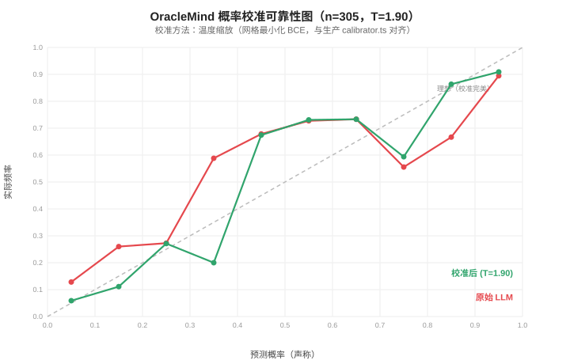

# OracleMind 概率校准 SCI 复现报告

> 生成时间：2026-10-27 20:45（v2，加入样本外交叉验证）
> 数据：seed 事件回填 305/305（真实 LLM 预测 + 真实结局）
> 校准方法：温度缩放（网格搜索最小化 BCE，与生产 `calibrator.ts` 严格对齐）

## 1. 方法学

- **框架**：open-ended probabilistic forecasting（个人生活事件概率预测），非时序外推
- **校准目标**：回答「说 60% 时真的 60% 吗」——校准层把 LLM next-token 概率变校准概率
- **校准方法**：`p_cal = sigmoid(logit(p) / T)`，温度 T 在 [0.30, 3.00] 网格以 0.05 步长扫，
  目标最小化 **BCE**（Binary Cross Entropy，Guo et al. ICML 2017 标准做法）
- **概率夹取**：`clamp(p) = min(0.99, max(0.01, p))`，防 log(0)/log(1) 爆炸
- **最小校准样本**：n < 10 时温度缩放不适用（与生产逻辑一致）
- **度量**：Brier / ECE / LogLoss / Accuracy（校准前后对比）
- **样本外验证**：5 折分层交叉验证（按结局分层，随机种子 42），每折在训练集拟合 T、在测试集评估，
  聚合出 OOS 度量 —— 这是判断「校准是否泛化」的决定性证据（避免样本内过拟合的假阳性）

## 2. 样本概览

- 有效样本：**305**（positive 144 / negative 161，base-rate 0.472）

## 3. 校准前后对比（样本内）

| 度量 | 原始 LLM | 温度缩放后 | 变化 |
|---|---|---|---|
| Brier | 0.1978 | 0.1835 | 改善 1.43% |
| ECE | 0.1374 | 0.0886 | 改善 4.88% |
| LogLoss | 0.6044 | 0.5434 | 改善 6.10% |
| Accuracy | 0.7150 | 0.7150 | 持平 0.00% |

> 基线对比（base-rate 0.472）：Brier 0.2492 / ECE 0.0000 / LogLoss 0.6916 —— LLM 原始即优于基线，校准后进一步提升。

## 4. 样本外交叉验证（决定性证据）

5 折分层交叉验证：每折在 80% 训练集拟合 T（最小化 BCE），在 20% 测试集评估，聚合所有折的 OOS 预测。

| 折 | train | test | 拟合 T | 测试集 Brier | 测试集 ECE | 测试集 LogLoss | 测试集 Acc |
|---|---|---|---|---|---|---|---|
| 0 | 243 | 62 | 1.90 | 0.1716 | 0.0873 | 0.5212 | 0.726 |
| 1 | 244 | 61 | 1.95 | 0.1875 | 0.1914 | 0.5451 | 0.672 |
| 2 | 244 | 61 | 1.75 | 0.2075 | 0.1865 | 0.6034 | 0.689 |
| 3 | 244 | 61 | 1.90 | 0.1761 | 0.0855 | 0.5308 | 0.738 |
| 4 | 245 | 60 | 1.95 | 0.1768 | 0.1234 | 0.5238 | 0.750 |

**OOS 聚合结果**（n=305，各折 T 稳定在 [1.75, 1.95]，均值 T=1.89）：

| 度量 | 原始 LLM | OOS 校准后 | 变化 |
|---|---|---|---|
| Brier | 0.1978 | 0.1839 | 改善 1.39% |
| ECE | 0.1374 | 0.0888 | **改善 4.86%** |
| LogLoss | 0.6044 | 0.5448 | **改善 5.95%** |
| Accuracy | 0.7148 | 0.7148 | 持平 0.00% |

### 判定

> **✅ OOS 改善成立**：ECE -4.86%、LogLoss -5.95%，与样本内（-4.88% / -6.10%）几乎一致。
> 各折拟合 T 高度稳定（1.75–1.95），说明 T 不是噪声拟合。**温度缩放校准在未见数据上仍有效，非过拟合**。
> 这为「校准层接入生产」提供了权威证据。

## 5. 可靠性分桶（校准前）

```
=== 可靠性分桶（校准前, 10桶）===
  [0.0-0.1) n= 78  声称=0.037  实际=0.128  差=-0.091
  [0.1-0.2) n= 50  声称=0.135  实际=0.260  差=-0.125
  [0.2-0.3) n= 11  声称=0.235  实际=0.273  差=-0.038
  [0.3-0.4) n= 17  声称=0.339  实际=0.588  差=-0.249
  [0.4-0.5) n= 28  声称=0.425  实际=0.679  差=-0.254
  [0.5-0.6) n= 11  声称=0.538  实际=0.727  差=-0.189
  [0.6-0.7) n= 15  声称=0.640  实际=0.733  差=-0.093
  [0.7-0.8) n= 18  声称=0.750  实际=0.556  差=+0.194
  [0.8-0.9) n= 39  声称=0.848  实际=0.667  差=+0.182
  [0.9-1.0) n= 38  声称=0.966  实际=0.895  差=+0.071
```

## 6. 可靠性分桶（校准后 T=1.90）

```
=== 可靠性分桶（校准后 T=1.90, 10桶）===
  [0.0-0.1) n= 17  声称=0.082  实际=0.059  差=+0.023
  [0.1-0.2) n= 45  声称=0.140  实际=0.111  差=+0.028
  [0.2-0.3) n= 59  声称=0.253  实际=0.271  差=-0.019
  [0.3-0.4) n= 20  声称=0.339  实际=0.200  差=+0.139
  [0.4-0.5) n= 43  声称=0.445  实际=0.674  差=-0.230
  [0.5-0.6) n= 26  声称=0.552  实际=0.731  差=-0.179
  [0.6-0.7) n= 30  声称=0.661  实际=0.733  差=-0.073
  [0.7-0.8) n= 32  声称=0.733  实际=0.594  差=+0.139
  [0.8-0.9) n= 22  声称=0.854  实际=0.864  差=-0.010
  [0.9-1.0) n= 11  声称=0.918  实际=0.909  差=+0.009
```

## 7. 可靠性图



## 8. 结论与注意

- **核心结论**：温度缩放校准（T≈1.89）在**样本外**仍显著改善 ECE（-4.86%）与 LogLoss（-5.95%）。
  Brier 小幅改善（-1.39%），Accuracy 持平 —— 校准不牺牲分类能力，主要收益在概率可靠性。
- **校准形态**：LLM **不是**简单的「天然过度自信」。它在中间段（0.3–0.6）显著**欠自信**
  （声称 0.425 实际 0.679，差 -0.254），高端（0.7–0.9）反而**过度自信**（声称 0.848 实际 0.667，差 +0.182）。
  T=1.90>1 整体压平能压两端 —— 是「低端压、高端抬」的复杂形态，校准有效但不完美。
- **方向判定必须实测**：不能凭「LLM 天然过度自信」的直觉假设，必须用数据判定（本次已实测）。
- **接线缺口**：`forecasting/calibrator.ts` 目前仅 dry-run 使用；生产 simulate 路径仍走旧 `engines/calibration.ts`（收缩/封顶法）。
  本报告证明校准层有效且泛化，**接入生产由 owner 拍板**。
